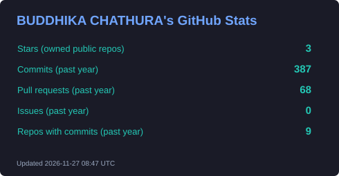
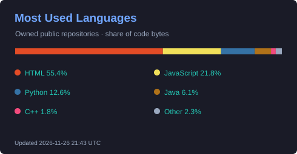
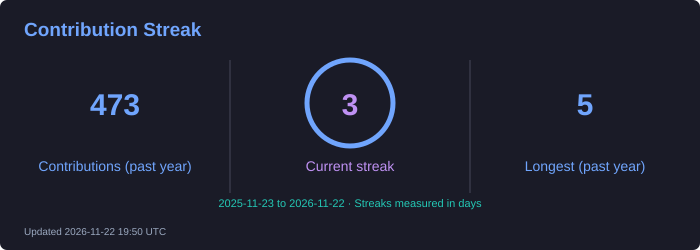
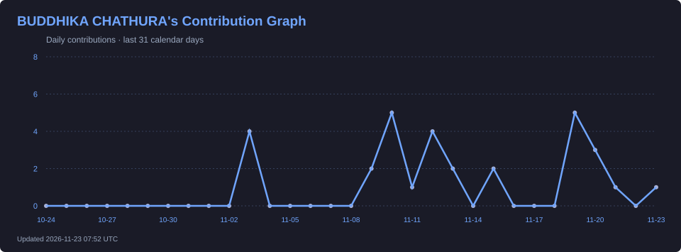

<p align="center"></p>

<p align="center"></p>

<p align="center">
  <a href="https://www.linkedin.com/in/buddhika-chathura/"></a>
  <a href="mailto:bchathura123@gmail.com"></a>
  <a href="https://github.com/Bbuddhika"></a>
  
</p>

<br />

##  About Me

<table>
<tr>
<td width="64%" valign="top">
<p>I'm an <strong>Information Technology undergraduate at the University of Moratuwa, Sri Lanka</strong>, passionate about software engineering, full-stack development, and building useful applications.</p>
<ul>
  <li>🎓 Pursuing <strong>BSc (Hons) in Information Technology</strong></li>
  <li>💻 Focused on <strong>Full-Stack Development &amp; Software Engineering</strong></li>
  <li>🛠️ Experience building admin consoles, REST APIs, and reporting dashboards</li>
  <li>🔧 Interested in <strong>IoT and hardware–software integration</strong></li>
  <li>🤝 Enjoy collaborative, team-based development</li>
  <li>🎯 Currently seeking a <strong>Software Engineering Internship</strong></li>
</ul>
</td>
<td width="36%" valign="top">
<p align="center"></p>

```yaml
name: Buddhika Chathura
role: IT Undergraduate
university: University of Moratuwa
location: Sri Lanka
focus:
  - Full-Stack Development
  - Backend Engineering
  - Cloud & DevOps
status: Open to Internships 🚀
```

</td>
</tr>
</table>

## 🛠️ Tech Stack

<table align="center">
<tr>
  <th>💻 Languages &amp; Frontend</th>
  <td></td>
</tr>
<tr>
  <th>⚙️ Backend &amp; Database</th>
  <td> </td>
</tr>
<tr>
  <th>☁️ Cloud &amp; DevOps</th>
  <td></td>
</tr>
<tr>
  <th>🧰 Tools</th>
  <td></td>
</tr>
</table>

## 💡 Areas of Interest

<p align="center">
  
  
  
  
  
  
  
</p>

## 📊 GitHub Stats

<p align="center">
  <a href="https://github.com/Bbuddhika?tab=repositories"></a>
  <a href="https://github.com/Bbuddhika?tab=repositories"></a>
</p>

<p align="center"><a href="https://github.com/Bbuddhika?tab=overview"></a></p>

<p align="center"><a href="https://github.com/Bbuddhika?tab=overview"></a></p>

<p align="center">
  <a href="https://github.com/Bbuddhika/Bbuddhika/actions/workflows/update-profile.yml"></a><br />
  <sub>Cards refresh approximately every 6 hours using GitHub-visible activity. Each card shows its refresh time.</sub>
</p>

## 🤝 Let's Connect

<p align="center">I'm happy to connect with fellow developers, learn from others, and explore internship opportunities.<br /><strong>Feel free to reach out!</strong></p>

<p align="center">
  <a href="mailto:bchathura123@gmail.com"></a>
  <a href="https://www.linkedin.com/in/buddhika-chathura/"></a>
</p>

<p align="center"><em>Building, learning, and improving — one project at a time.</em> 🚀</p>

<p align="center">Explore my projects in the pinned repositories below. ↓</p>
